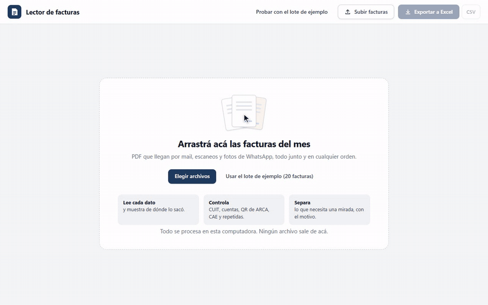
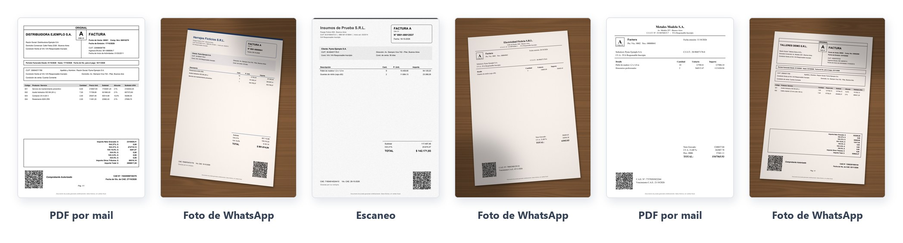
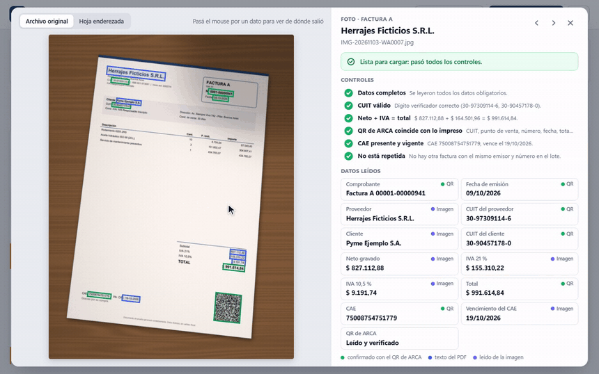
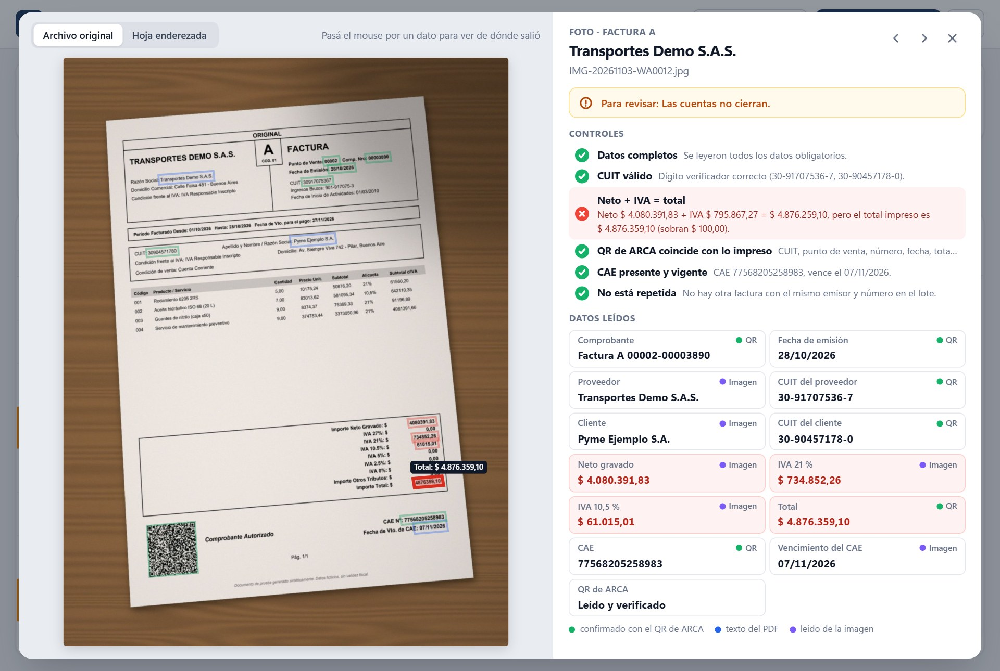
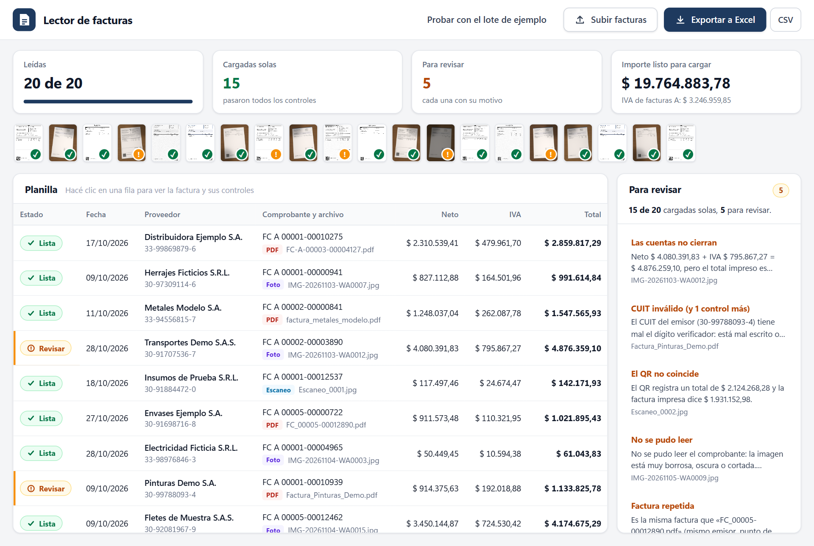
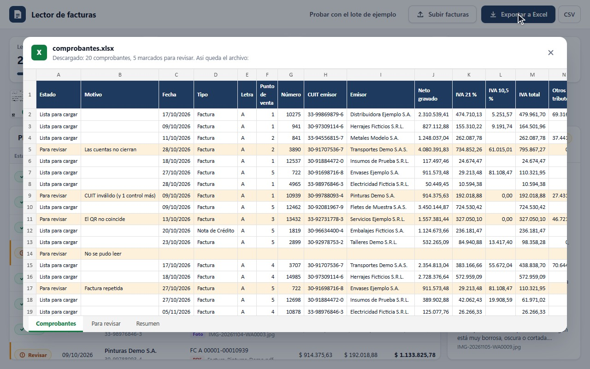
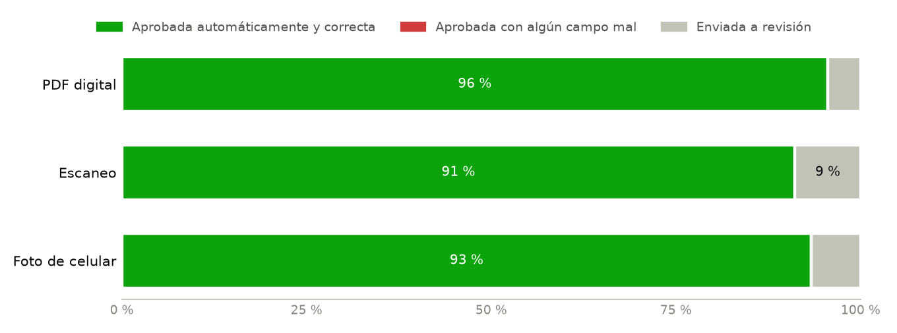

# Invoice Reading Demo
### Automatic invoice data entry, with checks

Small businesses in Argentina get their suppliers' invoices as e-mailed PDFs, scans or WhatsApp photos, and someone types each one into a spreadsheet or the accounting system. This system reads them all at once, fills in the spreadsheet and checks every invoice: tax ID (CUIT), arithmetic, the ARCA QR code, the authorization code (CAE) and duplicates. Invoices that pass every check are ready to load; the rest go to a review list, with the reason. It runs on an ordinary computer and the files never leave it.

**Tomás González** · Individual project · November 2026

[Presentation (PDF, Spanish)](docs/presentacion.pdf) · [Evaluation](docs/EVALUATION.md) · [Leer en español](README.md)

**Result:** on a batch of 20 mixed invoices (PDFs, scans and crooked phone photos), it loaded the 15 correct ones on its own and set aside the 5 that had a problem, each with its reason. On an independent test with 145 invoices in layouts it had never seen, it read 99.7 % of the fields correctly.

[Full video](figures/demo.mp4) · Companies, tax IDs and invoices are made up. The reading part is sped up. The interface is in Spanish.

## How it works

### 1. Upload the invoices as they come

They are dropped all together on a web page that runs on the computer itself: e-mailed PDFs, scans and photos taken with a phone on a desk, crooked and with shadows. No need to sort or rename them.

### 2. Read every field and show where it came from

PDFs: the text is taken directly. Photos and scans: the sheet is found, straightened and read (OCR). It also reads the ARCA QR code, which carries the CUIT, number, date, total and CAE without depending on the text reading. Every field is marked on the invoice, so it can be checked at a glance: green means it matches the QR.

### 3. Check every invoice

| Check | Catches |
| --- | --- |
| Valid CUIT (check digit) | Tax IDs that are mistyped, misread or made up |
| Net + VAT + other taxes = total | Wrong totals or misread amounts |
| ARCA QR matches the printed invoice | Altered invoices, or a QR that points to a site that isn't ARCA's |
| CAE present and valid | Missing CAE, CAE expired before the issue date, invoices marked "No Autorizado" |
| Not a duplicate | The same invoice twice, e.g. the e-mailed PDF and the WhatsApp photo |
| Complete data | A required field that could not be read |

Each check is shown with ✓ or ✗ and the reason in plain words, for example: *"Net $ 4,080,391.83 + VAT $ 795,867.27 = $ 4,876,259.10, but the printed total is $ 4,876,359.10 ($ 100.00 too much)"*.

### 4. Set aside what needs a look

Nothing that doesn't add up is loaded automatically. In the sample batch, 15 of 20 invoices were ready to load and 5 went to review: a total that doesn't match the sum, a CUIT with a wrong check digit, a QR that registers a different amount than the printed one, a blurry photo that can't be read, and an invoice that arrived twice. Each one is listed with its reason. This batch is meant to show how it works; the measurement is in step 6.

### 5. Export to Excel

One click downloads a ready-to-use Excel file with three sheets: every invoice (doubtful ones highlighted, with the reason), the review list, and a summary with the amount and VAT of the approved invoices. There is also a CSV with only the approved ones, semicolon separated, to import into another system.

### 6. Measure it

Two tests. The first is my own set of 50 fictitious invoices in three layouts, each one as a PDF, a scan and a phone photo (150 documents), with 5 invoices carrying deliberate errors. The second is a public dataset of 200 Argentine invoices made by someone else ([facturas_argentinas_2](https://huggingface.co/datasets/mauroibz/facturas_argentinas_2)), in 5 layouts the system had never seen: I tuned the rules looking at 55 of them and measured on the other 145.

| | Own set 150 documents, 3 capture types | Independent test 145 invoices, 5 unseen layouts |
| --- | :---: | :---: |
| Fields read correctly | 99.9 % | 99.7 % (image) · 99.3 % (photo) |
| Invoices with every field correct | 97.8 % | 96.6 % (image) · 91 % (photo) |
| Approved automatically with a wrong field | **0 of 135** | see note |
| Deliberately wrong invoices caught | **15 of 15** | — |

- **The third row matters most.** An invoice approved with a wrong value enters the books with nobody looking. Sending one to review costs a person a minute.
- **The photo test failed the first time.** On the first run of the 145 invoices as photos, 91.6 % of fields came out right: the system read "($)" as "(S)" and lost the net and VAT, and a missing value did not stop approval. I fixed it and added a check for that case. Since I found the bug by looking at that test, **the 99.3 % for photos is no longer blind**. Both runs are in [`results/`](results/).
- **Every invoice in the external dataset went to review, and that is correct:** they print "Comprobante No Autorizado" and their QR points to a site that isn't ARCA's. Had they been genuine, 98.6 % of the images would have been approved; 3 had a misread name, and none had a wrong amount, date, CUIT or number.

Full method and per-field tables: [EVALUATION.md](docs/EVALUATION.md).

## Conclusion

Reading invoices in different formats is the well-known part; what makes it usable is knowing when not to trust the reading. The ARCA QR code and the invoice's own arithmetic make it possible to verify almost every important field, and whatever doesn't add up goes to a person with the reason in plain sight. In a real business, the first step is to measure it on 50 to 100 of its own invoices before letting it load anything automatically.

## Limits and care

- **The tests use synthetic invoices.** Real ones add logos, stamps, folds and handwriting.
- **It reads the header and totals** of invoices and credit and debit notes. It does not extract line items or read delivery notes.
- **Names can't be verified.** The QR does not carry the company name, so a misread name is not caught by any check.
- **Personal data.** Invoices carry tax IDs, names and addresses, which are personal data under Argentine law (Ley 25.326). Everything runs on the computer; the demo deletes the files when it closes. In real use, access should be restricted and images kept no longer than needed.
- **A person decides the doubtful ones.** The system does not fix or approve what doesn't add up; it flags it and explains why.
- **Optional Claude fallback.** Invoices left for review can be sent to Claude for a second reading, which goes through the same checks. It is off by default; when turned on, the image leaves the computer. It has not been measured yet: none of the numbers on this page use it.

MIT license. Uses [RapidOCR](https://github.com/RapidAI/RapidOCR) and [OpenCV](https://opencv.org/) (Apache 2.0), [zxing-cpp](https://github.com/zxing-cpp/zxing-cpp) (Apache 2.0) and [pdfplumber](https://github.com/jsvine/pdfplumber) (MIT). Every invoice in this repository is fictitious. The [facturas_argentinas_2](https://huggingface.co/datasets/mauroibz/facturas_argentinas_2) dataset, by mauroibz, declares no license, so it is not redistributed and does not appear in any image.
