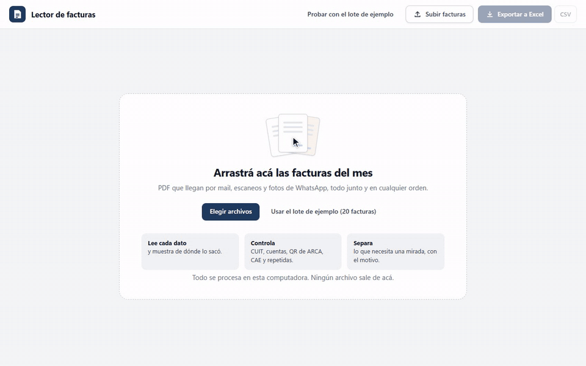
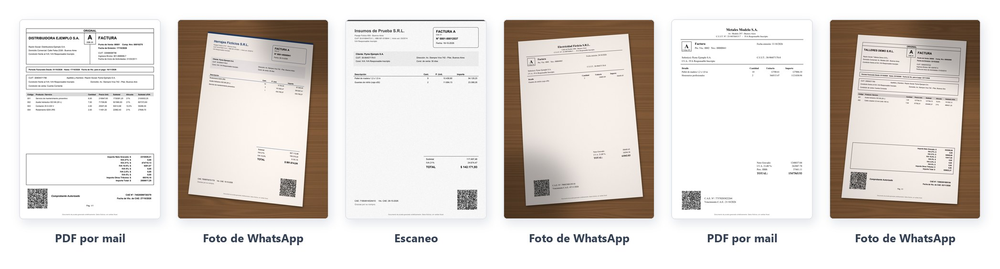
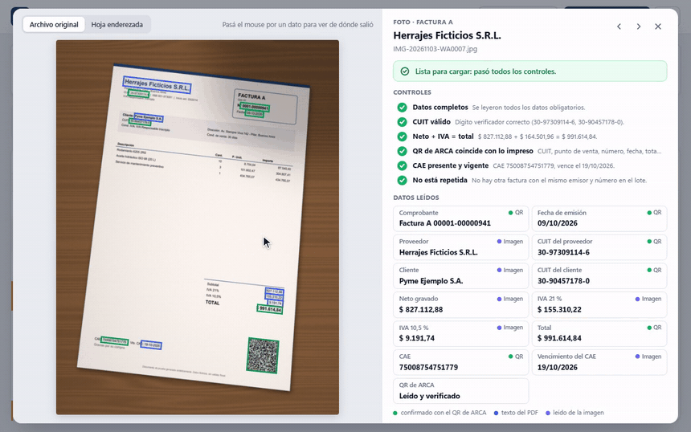
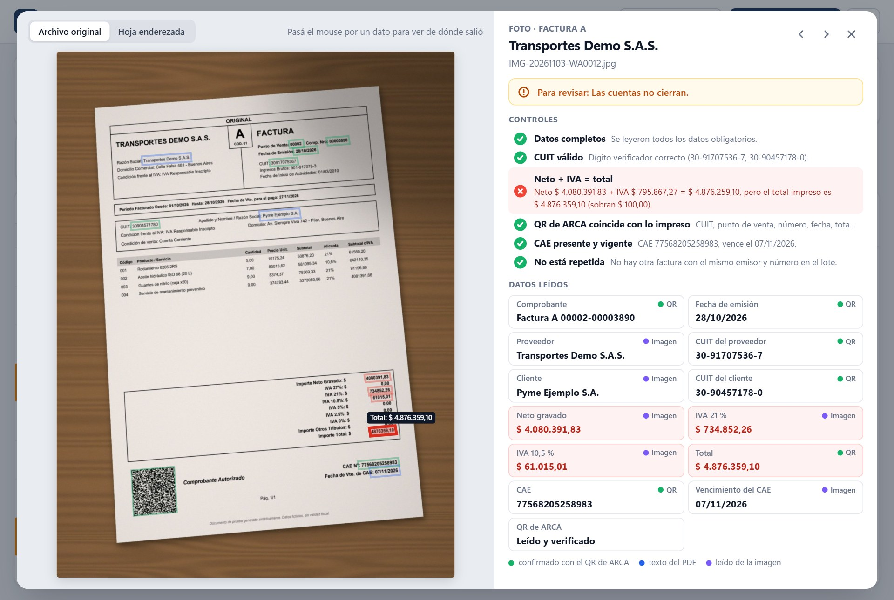
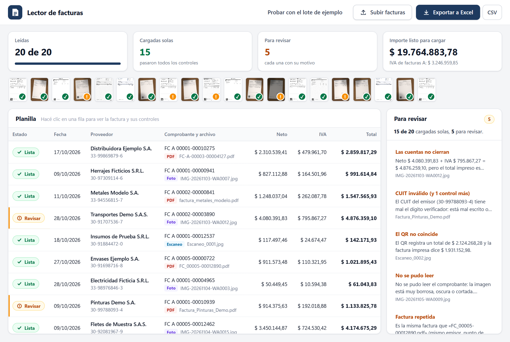
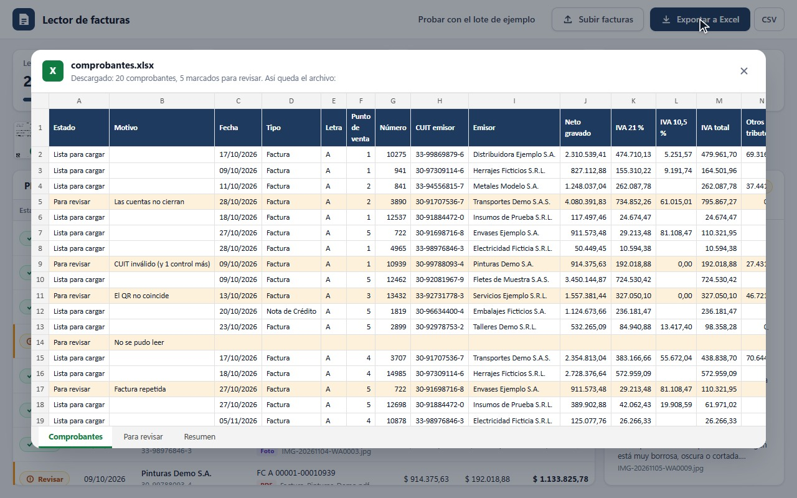
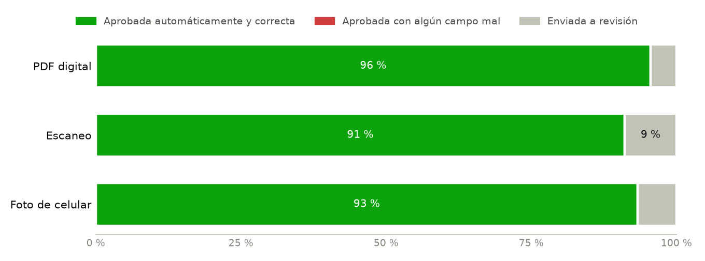

# Argentine Invoice Extraction
### Carga automática de facturas, con controles

Las pymes reciben las facturas de sus proveedores en PDF por mail, escaneadas o como foto por WhatsApp, y alguien las pasa a mano al Excel o al sistema contable. Este sistema las lee todas juntas, arma la planilla y controla cada una: CUIT, cuentas, QR de ARCA, CAE y facturas repetidas. Las que pasan todos los controles quedan listas para cargar; las demás van a una lista para revisar, con el motivo. Corre en una computadora común y los archivos no salen de ella.

**Tomás González** · Proyecto individual · noviembre de 2026

[Presentación (PDF)](docs/presentacion.pdf) · [Evaluación](docs/EVALUATION.md) · [Read in English](README.en.md)

**Resultado:** en un lote de 20 facturas mezcladas (PDF, escaneos y fotos torcidas), cargó solas las 15 que estaban bien y separó las 5 que tenían un problema, cada una con su motivo. En una prueba independiente, con 145 facturas de diseños que nunca había visto, leyó bien el 99,7 % de los datos.

[Video completo](figures/demo.mp4) · Empresas, CUIT y facturas inventados. La parte en que lee las facturas está acelerada.

## Recorrido

### 1. Subir las facturas como vengan

Se arrastran todas juntas a una página web que corre en la propia computadora: PDF del mail, escaneos y fotos sacadas con el celular sobre el escritorio, torcidas y con sombra. No hace falta ordenarlas ni renombrarlas.

### 2. Leer cada dato y mostrar de dónde salió

De los PDF toma el texto directamente. En fotos y escaneos encuentra la hoja, la endereza y lee el texto. Además lee el QR de ARCA, que trae CUIT, número, fecha, total y CAE sin depender de la lectura del texto. Cada dato queda marcado sobre la factura, así se puede comprobar de un vistazo: en verde, los que coinciden con el QR.

### 3. Controlar cada factura

| Control | Qué detecta |
| --- | --- |
| CUIT válido (dígito verificador) | CUIT mal escrito, mal leído o inventado |
| Neto + IVA + otros tributos = total | Totales mal calculados o montos mal leídos |
| QR de ARCA coincide con lo impreso | Facturas adulteradas, o un QR que lleva a un sitio que no es de ARCA |
| CAE presente y vigente | CAE faltante o vencido antes de la emisión, y comprobantes «No Autorizados» |
| No está repetida | La misma factura dos veces, por ejemplo el PDF del mail y la foto de WhatsApp |
| Datos completos | Un dato obligatorio que no se pudo leer |

Cada control se muestra con ✓ o ✗ y el motivo en palabras simples, por ejemplo: *«Neto $ 4.080.391,83 + IVA $ 795.867,27 = $ 4.876.259,10, pero el total impreso es $ 4.876.359,10 (sobran $ 100,00)»*.

### 4. Separar lo que necesita una mirada

Nada que no cierre se carga solo. En el lote de ejemplo, de 20 facturas quedaron 15 listas para cargar y 5 para revisar: un total que no coincide con la suma, un CUIT con el dígito verificador mal, un QR que registra otro importe que el impreso, una foto movida que no se puede leer y una factura que llegó dos veces. Cada una aparece en la lista con su motivo. Es un lote armado para mostrar el sistema, no para medirlo: la medición está en el paso 6, y lo que ajusté del lote, en [EVALUATION.md](docs/EVALUATION.md#3-demo-batch-demolote).

### 5. Exportar a Excel

Con un clic se descarga un Excel listo para usar, con tres hojas: todos los comprobantes (los dudosos resaltados, con el motivo), la lista para revisar y un resumen con el importe y el IVA de las facturas aprobadas. También hay un CSV con solo las aprobadas, separado por punto y coma, para importar en otro sistema.

### 6. Medirlo

Lo medí con dos pruebas. La primera es un set propio de 50 facturas ficticias en tres diseños, cada una como PDF, escaneo y foto de celular (150 documentos), con 5 facturas con errores puestos a propósito. La segunda es un dataset público de 200 facturas argentinas hecho por otra persona ([facturas_argentinas_2](https://huggingface.co/datasets/mauroibz/facturas_argentinas_2)), con 5 diseños que el sistema nunca había visto: ajusté las reglas mirando 55 y medí sobre las otras 145.

| | Set propio 150 documentos, 3 tipos de captura | Prueba independiente 145 facturas, 5 diseños nunca vistos |
| --- | :---: | :---: |
| Datos leídos bien | 99,9 % | 99,7 % (imagen) · 99,3 % (foto) |
| Facturas con todos los datos bien | 97,8 % | 96,6 % (imagen) · 91 % (foto) |
| Aprobadas solas con algún dato mal | **0 de 135** | ver nota |
| Facturas con errores a propósito detectadas | **15 de 15** | — |

- **La fila que más importa es la tercera.** Una factura aprobada con un dato mal entra a la contabilidad sin que nadie la mire. Mandar una a revisión le cuesta un minuto a una persona.
- **La prueba con fotos falló la primera vez.** En la primera corrida de las 145 facturas como fotos salió bien el 91,6 % de los datos: el sistema leía «($)» como «(S)» y perdía el neto y el IVA, y un dato faltante no frenaba la aprobación. Lo corregí y agregué un control para ese caso. Como el error lo encontré mirando esa prueba, **el 99,3 % de fotos ya no es a ciegas**. Las dos corridas están en [`results/`](results/).
- **Todas las facturas del dataset externo fueron a revisión, y es lo correcto:** imprimen «Comprobante No Autorizado» y su QR lleva a un sitio que no es de ARCA. Si hubieran sido genuinas, se habría aprobado el 98,6 % de las imágenes; en 3 había un nombre mal leído, y en ninguna un monto, fecha, CUIT o número equivocado.

El método completo y las tablas por campo están en [EVALUATION.md](docs/EVALUATION.md).

## Conclusión

Leer facturas de distintos formatos es la parte conocida; lo que hace que se pueda usar es saber cuándo no confiar en lo leído. El QR de ARCA y las cuentas de la propia factura permiten comprobar casi todos los datos importantes, y lo que no cierra va a una persona con el motivo a la vista. En una empresa real, el primer paso es medirlo con 50 a 100 facturas propias antes de dejar que cargue solo.

## Límites y cuidados

- **Las pruebas son con facturas sintéticas.** Las reales suman logos, sellos, dobleces y escritura a mano.
- **Lee encabezado y totales** de facturas y notas de crédito y débito. No extrae el detalle de ítems ni lee remitos.
- **Los nombres no se pueden verificar.** El QR no trae la razón social, así que un error de lectura en un nombre no lo detecta ningún control.
- **Datos personales.** Las facturas tienen CUIT, nombres y domicilios, que son datos personales (Ley 25.326). Todo corre en la computadora; la demo borra los archivos al cerrarse. En un uso real conviene restringir quién accede y no guardar las imágenes más tiempo del necesario.
- **Lo dudoso lo decide una persona.** El sistema no corrige ni aprueba lo que no cierra; lo marca y explica por qué.
- **Ayuda opcional de Claude.** Las facturas que quedan para revisar se le pueden pasar a Claude para una segunda lectura, que vuelve a pasar por los mismos controles. Viene apagada; si se activa, la imagen sale de la computadora. Todavía no la medí: ningún número de esta página la usa.

Licencia MIT. Usa [RapidOCR](https://github.com/RapidAI/RapidOCR) y [OpenCV](https://opencv.org/) (Apache 2.0), [zxing-cpp](https://github.com/zxing-cpp/zxing-cpp) (Apache 2.0) y [pdfplumber](https://github.com/jsvine/pdfplumber) (MIT). Todas las facturas del repositorio son ficticias. El dataset [facturas_argentinas_2](https://huggingface.co/datasets/mauroibz/facturas_argentinas_2), de mauroibz, no declara licencia, así que no se redistribuye ni aparece en ninguna imagen.
